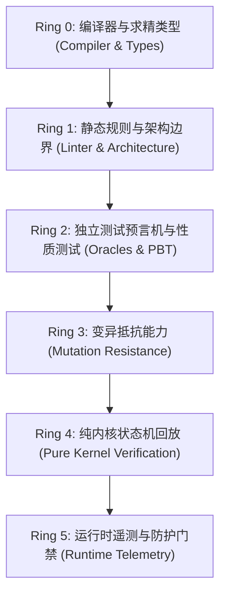

# 08. 验收意图与六层验证

用于梳理新需求、设计复杂状态机、定义核心不变量或进行端到端质量验证。

## 一、 Giovanni Ruggiero 六层验证环 (Six Validation Rings)

每个环针对不同类型的错误，层层递进，构建纵深防御体系：

| 验证环 | 验证手段与工具 | 能确立的确定性不变量 |
| :--- | :--- | :--- |
| **Ring 0: 编译器/求精类型** | Scala 3 强类型、`-Wnonunit-statement`、smart constructor | 杜绝非法状态构造、类型错误、丢弃未执行的副作用。 |
| **Ring 1: 静态/架构规则** | `ArchitectureSpec`、Scalafix、Scalafmt | 杜绝层级穿透（如 domain 依赖 web/db）、格式不一致。 |
| **Ring 2: 独立测试预言机** | ZIO Test、ScalaCheck (PBT)、冻结的 Gold 数据 | 验证业务逻辑行为正确性，预期结果独立于被测代码。 |
| **Ring 3: 变异抵抗能力** | 变异推演、Stryker4s 思维 | 验证测试是否有效（反转条件、删除租户过滤时必须报错）。 |
| **Ring 4: 纯函数内核** | 纯状态转换回放、代数数据树求值 | 状态机转移具备 100% 确定性与可复现性，无偶发随机。 |
| **Ring 5: 运行时遥测** | OpenTelemetry、Prometheus 指标、Guardrail 门禁 | 生产环境中的配额、超时、降级熔断、注入攻击拦截与告警。 |

*注：并非每次微小改动都要跑满六环，而是根据任务风险按需激活对应层次的防护。*

## 二、 EARS 需求语法规范 (Easy Approach to Requirements Syntax)

在编写变更规范（Change Spec）或定义验收条件时，必须使用 EARS 语法，将模糊的自然语言转化为计算机可精确校验的因果逻辑：

1. **通用不变量 (Ubiquitous)**：
   `THE SYSTEM SHALL <system response>`  
   *例*：`THE SYSTEM SHALL 在导出 IncidentPack 时彻底抹除原始 Prompt 与模型凭据。`
2. **事件驱动条件 (Event-Driven)**：
   `WHEN <trigger> THE SYSTEM SHALL <system response>`  
   *例*：`WHEN 检索来源在生成前被知识库管理员撤回 THE SYSTEM SHALL 在最终回答中移除对应的引用标注。`
3. **状态驱动约束 (State-Driven)**：
   `WHILE <state condition> THE SYSTEM SHALL <system response>`  
   *例*：`WHILE Worker 的 Fencing Token 处于过期状态 THE SYSTEM SHALL 拒绝该 Worker 提交的任何写事务。`
4. **异常恢复条件 (Unwanted Event)**：
   `IF <error condition> THEN THE SYSTEM SHALL <system response>`  
   *例*：`IF 外部大模型 API 返回 429 速率限制 THEN THE SYSTEM SHALL 触发退避指数重试并在达到上限后降级为备用模型。`
5. **可选特性条件 (Optional Feature)**：
   `WHERE <feature is enabled> THE SYSTEM SHALL <system response>`  
   *例*：`WHERE 严格合规检查处于开启状态 THE SYSTEM SHALL 在未匹配到站内证据时返回安全拒答模板。`

## 三、 概念盘点清单 (Concepts Inventory)

在编写任何具体实现代码之前，先对照现有仓库执行“概念盘点”，严禁创造平行或重名的概念：
- [ ] **领域标识符**：已有哪个 `*Id`？（如 `UserId`、`DocumentId`、`RunId`，复用已有 opaque types）
- [ ] **互斥状态机**：已有哪个状态 `enum`？（如 `RunStatus`、`DocumentState`，切勿新建相似枚举）
- [ ] **错误通道**：当前模块使用的错误 ADT 是什么？（如 `AgentError`、`QaError`，切勿强行发明新错误树）
- [ ] **持久化仓储**：已有哪个 Repository 负责该领域实体的生命周期？
